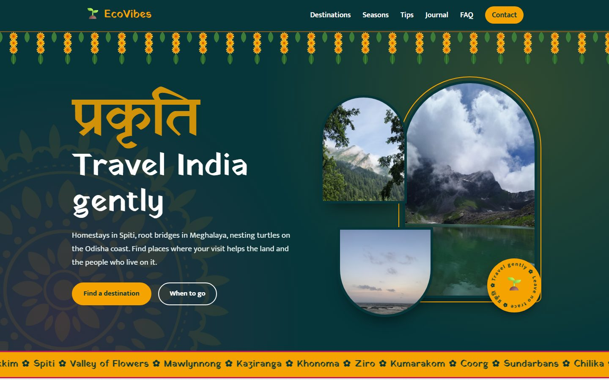
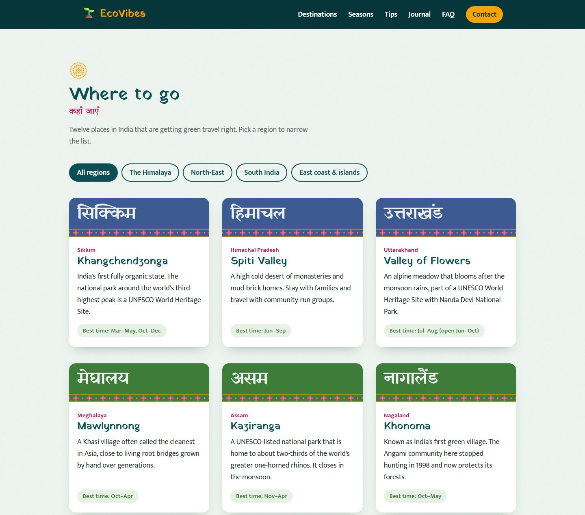
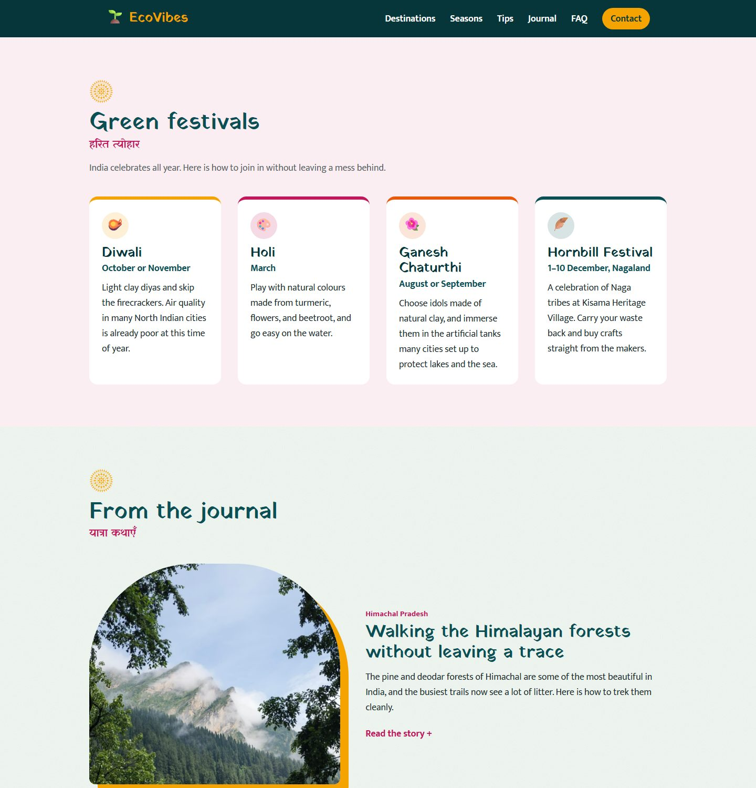
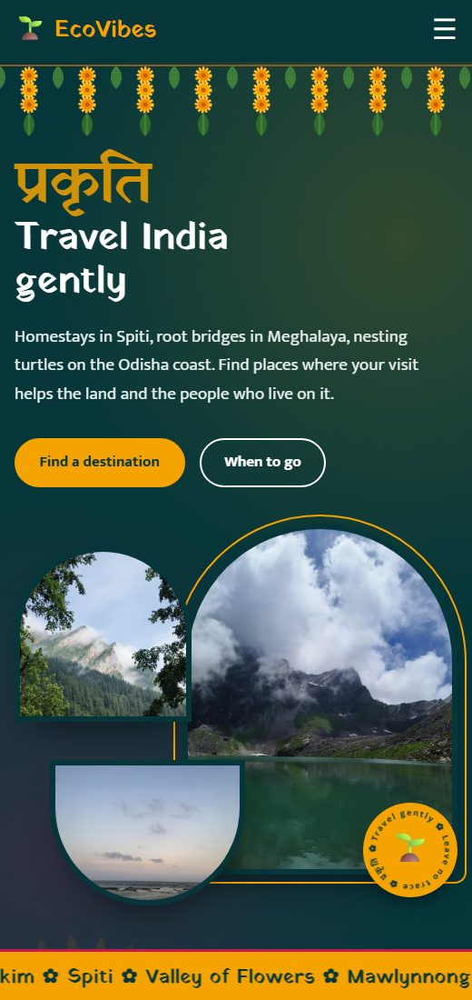

# EcoVibes 🌱

A **responsive static website** about **eco-tourism and sustainable travel in India**, built using **HTML5 & CSS3** (no JavaScript).  
The website works on desktop, tablet, and mobile, and includes SEO meta tags.

---

## 📸 Screenshots



<p align="center">
  
  
  
</p>

---

## 🚀 Features
- Responsive navbar with a CSS-only mobile menu
- Hero with a marigold toran, photo collage in temple-arch frames, rotating stamp, and mandala
- Scrolling ribbon of destination names
- Indian design details: block-print borders, arched section edges, Devanagari headings
- 12 eco-friendly destinations across India with a CSS-only region filter
- "When to go" season cards for India's climates
- Eco travel tips, getting-around guide, and a tick-off packing list
- Green festivals guide (Diwali, Holi, Ganesh Chaturthi, Hornbill)
- Journal stories with expandable "Read the story" sections
- Useful Hindi and regional words for travellers
- FAQ on permits, water, national parks, and the monsoon
- About section and "Get in touch" links (email, Gmail, GitHub issues, social media)
- SEO-friendly meta tags and an SVG favicon

---
## 🛠️ Technologies Used
- **HTML5** (semantic structure, SEO)
- **CSS3** (grid, flexbox, media queries, custom properties)
- **Git & GitHub** (version control)

---

## 💻 View Locally
The mandala decorations use a CSS mask, which browsers block when a page is opened straight from disk.
Serve the folder instead:

```bash
python -m http.server
```

Then open http://localhost:8000.

---
